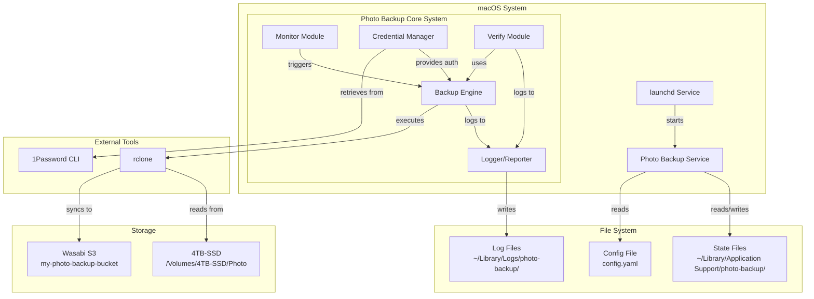

# Photo Backup System Architecture

## Overview

The Photo Backup System is a Python-based automated backup solution that monitors a local photo collection on an external SSD and maintains synchronized copies on Wasabi S3 storage, following the 3-2-1 backup methodology.

## System Architecture Diagram



## Directory Structure

### Project Structure
```
photo-backup/
├── setup.py                    # Package installation configuration
├── install.py                  # System setup script (launchd, directories)
├── requirements.txt            # Python dependencies
├── config.yaml.example         # Configuration template
├── README.md                   # User documentation
├── LICENSE                     # License file
├── .gitignore                 # Git ignore rules
│
├── photo_backup/              # Main package directory
│   ├── __init__.py           # Package initialization
│   ├── __version__.py        # Version information
│   ├── main.py               # Entry point and CLI interface
│   ├── backup.py             # Core backup orchestration logic
│   ├── monitor.py            # File system monitoring
│   ├── credentials.py        # 1Password integration
│   ├── verify.py             # Integrity verification
│   ├── config.py             # Configuration management
│   ├── logger.py             # Logging setup and management
│   └── utils.py              # Utility functions
│
├── tests/                     # Test suite
│   ├── __init__.py
│   ├── test_backup.py
│   ├── test_monitor.py
│   ├── test_credentials.py
│   ├── test_verify.py
│   └── fixtures/             # Test data
│
└── scripts/                   # Utility scripts
    ├── uninstall.py          # Clean removal script
    └── debug.py              # Diagnostic tool
```

### System Directories (Created by installer)
```
~/Library/Application Support/photo-backup/
├── state/                     # Persistent state files
│   ├── last_sync.json        # Last successful sync metadata
│   ├── sync_history.db       # SQLite database for sync history
│   └── verification_cache.json # Hash cache for verification
│
├── config/                    # Configuration files
│   └── config.yaml           # User configuration
│
└── temp/                      # Temporary files
    └── .pid                  # Process ID for singleton

~/Library/Logs/photo-backup/   # Log files
├── backup.log                # Main log file (rotated)
├── backup.log.1              # Rotated logs
├── backup.log.2
├── errors.log                # Error-only log
└── reports/                  # Verification reports
    └── verify_20250621.md    # Dated verification reports

~/Library/LaunchAgents/        # macOS service definition
└── com.example.photo-backup.plist
```

## Component Details

### 1. Entry Point (`main.py`)
**Purpose**: CLI interface and command routing
- Handles command-line arguments
- Routes to appropriate actions (sync, verify, status)
- Manages daemon vs one-shot execution
- Implements singleton pattern to prevent multiple instances

**Key Functions**:
- `main()`: Entry point
- `sync_command()`: Manual sync trigger
- `verify_command()`: Manual verification
- `status_command()`: Show current status
- `daemon_command()`: Run as background service

### 2. Backup Engine (`backup.py`)
**Purpose**: Core backup orchestration
- Coordinates the entire backup workflow
- Manages rclone subprocess execution
- Handles retry logic and error recovery
- Tracks backup state and progress

**Key Classes**:
- `BackupEngine`: Main orchestrator
- `BackupJob`: Single backup operation
- `BackupStats`: Statistics tracking

**Key Methods**:
- `execute_backup()`: Run full backup cycle
- `sync_to_wasabi()`: rclone wrapper
- `handle_errors()`: Error recovery logic

### 3. File Monitor (`monitor.py`)
**Purpose**: Detect changes in photo directory
- Watches for file system events
- Implements 4-hour check interval
- Detects drive mount/unmount
- Triggers backups on changes

**Key Classes**:
- `PhotoMonitor`: Main monitoring class
- `ChangeDetector`: Change detection logic
- `DriveWatcher`: USB drive detection

**Uses**: `watchdog` library for efficient file system monitoring

### 4. Credentials Manager (`credentials.py`)
**Purpose**: Secure credential retrieval
- Interfaces with 1Password CLI
- Caches session for efficiency
- Handles authentication failures
- Never stores credentials on disk

**Key Functions**:
- `get_wasabi_credentials()`: Retrieve from 1Password
- `refresh_session()`: Handle session expiry
- `validate_credentials()`: Verify credentials work

### 5. Verification Module (`verify.py`)
**Purpose**: Ensure backup integrity
- Monthly full verification
- Compare local vs remote hashes
- Auto-repair mismatches
- Generate verification reports

**Key Classes**:
- `IntegrityVerifier`: Main verification logic
- `HashComparator`: Hash comparison
- `RepairEngine`: Fix mismatches

### 6. Configuration (`config.py`)
**Purpose**: Centralized configuration management
- Load YAML configuration
- Provide defaults
- Validate settings
- Hot-reload capability

**Configuration Schema**:
```yaml
# config.yaml
backup:
  source_path: "/Volumes/4TB-SSD/Photo"
  destination: "wasabi-photo:my-photo-backup-bucket"
  
monitoring:
  check_interval_hours: 4
  mount_delay_minutes: 15
  change_delay_minutes: 30
  
verification:
  monthly_day: 1  # Day of month to run
  auto_repair: true
  
rclone:
  transfers: 8
  checkers: 16
  s3_chunk_size: "10M"
  s3_upload_concurrency: 4
  
logging:
  level: "INFO"
  max_size_mb: 100
  backup_count: 5
  
notifications:
  errors_to_terminal: true
```

### 7. Logger (`logger.py`)
**Purpose**: Comprehensive logging system
- Structured logging with rotation
- Multiple log levels
- Separate error log
- Report generation

**Features**:
- Console and file output
- JSON structured logs for parsing
- Automatic rotation at size limit
- Contextual logging (job IDs)

### 8. Utilities (`utils.py`)
**Purpose**: Shared helper functions
- Path manipulation
- Size formatting
- Time calculations
- Process management

## State Management

### Persistent State Files

#### 1. `last_sync.json`
```json
{
  "timestamp": "2025-06-21T10:30:00Z",
  "duration_seconds": 3600,
  "files_synced": 150,
  "bytes_transferred": 5368709120,
  "errors": [],
  "version": "1.0.0"
}
```

#### 2. `sync_history.db` (SQLite)
```sql
CREATE TABLE sync_runs (
    id INTEGER PRIMARY KEY,
    start_time TIMESTAMP,
    end_time TIMESTAMP,
    status TEXT,
    files_synced INTEGER,
    bytes_transferred INTEGER,
    errors TEXT
);

CREATE TABLE file_history (
    id INTEGER PRIMARY KEY,
    filepath TEXT,
    last_synced TIMESTAMP,
    size INTEGER,
    hash TEXT
);
```

#### 3. `verification_cache.json`
```json
{
  "last_full_verify": "2025-06-01T00:00:00Z",
  "cached_hashes": {
    "/2024/IMG_001.jpg": {
      "hash": "abc123...",
      "size": 4567890,
      "mtime": "2024-05-15T10:30:00Z"
    }
  }
}
```

## Service Integration

### launchd Configuration
The system integrates with macOS launchd for automatic startup:

```xml
<?xml version="1.0" encoding="UTF-8"?>
<!DOCTYPE plist PUBLIC "-//Apple//DTD PLIST 1.0//EN">
<plist version="1.0">
<dict>
    <key>Label</key>
    <string>com.example.photo-backup</string>
    
    <key>ProgramArguments</key>
    <array>
        <string>/usr/bin/python3</string>
        <string>/path/to/photo_backup/main.py</string>
        <string>daemon</string>
    </array>
    
    <key>StartOnMount</key>
    <dict>
        <key>/Volumes/4TB-SSD</key>
        <true/>
    </dict>
    
    <key>RunAtLoad</key>
    <false/>
    
    <key>KeepAlive</key>
    <dict>
        <key>PathState</key>
        <dict>
            <key>/Volumes/4TB-SSD</key>
            <true/>
        </dict>
    </dict>
</dict>
</plist>
```

## Process Flow

### 1. Startup Flow
```
launchd detects drive mount
    ↓
Starts photo-backup service
    ↓
main.py checks singleton lock
    ↓
Loads configuration
    ↓
Initializes logging
    ↓
Waits 15 minutes (mount delay)
    ↓
Enters monitoring loop
```

### 2. Backup Flow
```
Change detected / Timer elapsed
    ↓
Retrieve Wasabi credentials from 1Password
    ↓
Build rclone command with parameters
    ↓
Execute rclone sync subprocess
    ↓
Monitor progress and handle errors
    ↓
Update state files
    ↓
Log results and statistics
```

### 3. Verification Flow
```
Monthly timer triggers
    ↓
Load cached hashes
    ↓
List all local files
    ↓
List all remote files (rclone)
    ↓
Compare hashes
    ↓
For mismatches:
    - Log discrepancy
    - Re-upload file
    - Update cache
    ↓
Generate verification report
```

## Security Considerations

1. **Credentials**: Never stored on disk, always fetched from 1Password
2. **Permissions**: Config files are 600, logs are 644
3. **Process**: Runs as user, not root
4. **Network**: HTTPS only to Wasabi
5. **Validation**: Input sanitization for paths

## Performance Considerations

1. **Concurrency**: Leverages rclone's built-in parallelism
2. **Caching**: Hash cache reduces verification time
3. **Incremental**: Only syncs changed files
4. **Bandwidth**: Respects 250 Mbps limit via rclone settings
5. **Memory**: Streaming processing, no full file list in memory

## Error Handling Strategy

1. **Network Errors**: Exponential backoff with max 3 retries
2. **File Errors**: Log and continue, report at end
3. **Permission Errors**: Fail gracefully with clear message
4. **Credential Errors**: Prompt for re-authentication
5. **Drive Disconnection**: Clean shutdown, resume on reconnect

## Future Extension Points

1. **Web UI**: Add Flask/FastAPI web interface
2. **Multiple Sources**: Support multiple photo directories
3. **Cloud Providers**: Add Google Drive, Dropbox support
4. **Smart Scheduling**: ML-based optimal backup times
5. **Mobile App**: iOS app for monitoring
6. **Catalog Backup**: Integrate Luminar Neo catalog files