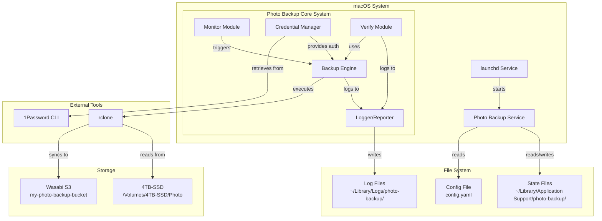

---
aliases:
tags:
  - architecture
  - backup
  - design
  - project
creation_date: 2025-06-21
---

# Photo Backup System Architecture

## Overview

The Photo Backup System is a Python-based automated backup solution that monitors a local photo collection on an external SSD and maintains synchronized copies on Wasabi S3 storage, following the 3-2-1 backup methodology.

## System Architecture Diagram



## Directory Structure

### Project Structure

````text
photo-backup/
├── setup.py                    # Package installation configuration
├── pyproject.toml              # Modern Python project configuration
├── pytest.ini                 # pytest configuration
├── Makefile                    # Build and development commands
├── requirements.txt            # Python dependencies
├── requirements-dev.txt        # Development dependencies
├── config.yaml.example         # Configuration template
├── README.md                   # User documentation
├── test_basic.py              # Basic functionality test
├── .gitignore                 # Git ignore rules
│
├── photo_backup/              # Main package directory
│   ├── __init__.py           # Package initialization
│   ├── __version__.py        # Version information
│   ├── main.py               # Entry point and CLI interface
│   ├── progress_parser.py    # rclone progress parsing
│   ├── consts.py             # Application constants
│   │
│   ├── backup/               # Backup engine module
│   │   ├── __init__.py       # Public API exports
│   │   ├── engine.py         # Main BackupEngine orchestration
│   │   ├── job.py            # BackupJob representation
│   │   ├── stats.py          # Backup statistics and metrics
│   │   ├── errors.py         # Error detection and categorization
│   │   ├── state.py          # State management and persistence
│   │   └── rclone_utils.py   # rclone utilities and version checking
│   │
│   ├── cli/                  # CLI command modules
│   │   ├── __init__.py
│   │   ├── auth_commands.py  # Authentication commands
│   │   ├── config_commands.py # Configuration commands
│   │   ├── log_commands.py   # Log viewing commands
│   │   ├── status_commands.py # Status and health commands
│   │   └── sync_commands.py  # Manual sync commands
│   │
│   ├── config/               # Configuration system
│   │   ├── __init__.py
│   │   ├── config.py         # Core configuration class
│   │   ├── defaults.py       # Default configuration values
│   │   ├── env_override.py   # Environment variable overrides
│   │   ├── loader.py         # Configuration loading logic
│   │   ├── utils.py          # Configuration utilities
│   │   └── validator.py      # Configuration validation
│   │
│   ├── credentials/          # Credential management system
│   │   ├── __init__.py
│   │   ├── manager.py        # Main credential manager
│   │   ├── exceptions.py     # Credential-specific exceptions
│   │   ├── utils.py          # Credential utilities
│   │   ├── providers/        # Credential providers
│   │   │   ├── __init__.py
│   │   │   ├── base.py       # Base provider interface
│   │   │   ├── direct.py     # Direct credential provider (handles both test and production)
│   │   │   └── onepassword.py # 1Password integration
│   │   ├── session/          # Session management
│   │   │   ├── __init__.py
│   │   │   └── onepassword.py # 1Password session handling
│   │   └── validators/       # Credential validators
│   │       ├── __init__.py
│   │       ├── base.py       # Base validator interface
│   │       └── rclone.py     # rclone-based validation
│   │
│   ├── logger/               # Comprehensive logging system
│   │   ├── __init__.py
│   │   ├── core.py           # Core logger setup
│   │   ├── formatters.py     # Log formatters (JSON, detailed, simple)
│   │   ├── context.py        # Operation context tracking
│   │   ├── progress.py       # Progress logging
│   │   ├── summary.py        # Summary statistics
│   │   ├── cleanup.py        # Log cleanup functionality
│   │   └── utils.py          # Logger utilities
│   │
│   ├── monitor/              # File system monitoring
│   │   ├── __init__.py       # Public API exports
│   │   ├── monitor.py        # Main DriveMonitor class
│   │   ├── events.py         # Monitoring events and states
│   │   └── state.py          # Persistent state management
│   │
│   ├── service/              # Service management
│   │   ├── __init__.py       # Public API exports
│   │   └── manager.py        # ServiceManager for lifecycle control
│   │
│   ├── verify.py             # Integrity verification (future)
│   │
│   └── *_utils.py            # Utility modules
│       ├── format_utils.py   # Formatting utilities
│       ├── fs_utils.py       # File system utilities
│       ├── lock_utils.py     # Process locking utilities
│       ├── process_utils.py  # Process execution utilities
│       ├── state_utils.py    # State management utilities
│       └── time_utils.py     # Time calculation utilities
│
├── tests/                     # Comprehensive test suite
│   ├── __init__.py
│   ├── conftest.py           # pytest configuration
│   ├── fixtures/             # Test data and fixtures
│   │   ├── __init__.py
│   │   └── photo_fixtures.py # Test photo generation
│   │
│   ├── unit/                 # Unit tests
│   │   ├── cli/              # CLI command tests
│   │   ├── config/           # Configuration system tests
│   │   ├── credentials/      # Credential management tests
│   │   ├── logger/           # Logging system tests
│   │   ├── service/          # Service management tests
│   │   └── test_*.py         # Individual module tests
│   │
│   ├── functional/           # End-to-end functional tests
│   │   └── test_*.py         # Full workflow tests with Minio
│   │
│   └── integration/          # Integration tests
│       └── test_*.py         # Component interaction tests
│
└── scripts/                   # Utility scripts (planned, not yet implemented)
    ├── uninstall.py          # Clean removal script (future)
    └── debug.py              # Diagnostic tool (future)

# Project Management Files (Root Level)

```text
backup-to-s3/                  # Project root directory
├── architecture.md           # This architecture document
├── CLAUDE.md                 # Development progress tracking
├── instructions.md           # Project instructions
├── tasks.md                  # Task definitions and requirements
├── Progress/                 # Progress tracking directory
│   └── progress.yaml         # Current progress status
└── tests/                    # Additional test directory
    └── unit/
        └── logger/           # Logger-specific unit tests
````

### System Directories (Created by installer)

```text
~/Library/Application Support/photo-backup/
├── state/                     # Persistent state files
│   ├── last_sync.json        # Last successful sync metadata
│   ├── sync_history.db       # SQLite database for sync history
│   └── verification_cache.json # Hash cache for verification
│
├── config/                    # Configuration files
│   └── config.yaml           # User configuration
│
└── temp/                      # Temporary files
    └── .pid                  # Process ID for singleton

~/Library/Logs/photo-backup/   # Log files
├── backup.log                # Main log file (rotated)
├── backup.log.1              # Rotated logs
├── backup.log.2
├── errors.log                # Error-only log
└── reports/                  # Verification reports
    └── verify_20250621.md    # Dated verification reports

~/Library/LaunchAgents/        # macOS service definition
└── com.example.photo-backup.plist
```

## Component Details

### 1. Entry Point (`main.py`)

**Purpose**: CLI interface and command routing

- Handles command-line arguments
- Routes to appropriate CLI command modules
- Manages daemon vs one-shot execution
- Implements singleton pattern to prevent multiple instances

**Key Functions**:

- `main()`: Entry point with click CLI framework
- Command routing to specialized CLI modules
- Global flag handling (--test-mode, --dry-run, --verbose)

### 2. CLI Command System (`cli/`)

**Purpose**: Modular command-line interface

- **`cli/auth_commands.py`**: Authentication and credential testing
- **`cli/config_commands.py`**: Configuration display and validation
- **`cli/log_commands.py`**: Log viewing and filtering
- **`cli/service_commands.py`**: Service lifecycle management (start/stop/restart)
- **`cli/status_commands.py`**: System status and health monitoring
- **`cli/sync_commands.py`**: Manual backup synchronization

**Key Commands**:

- `photo-backup config`: Display current configuration
- `photo-backup validate`: Validate configuration and dependencies
- `photo-backup test-auth`: Test credential authentication
- `photo-backup logs`: View and filter log files
- `photo-backup status`: Show system status and health information
- `photo-backup sync`: Run manual backup synchronization
- `photo-backup setup-config`: Initialize user configuration
- `photo-backup start`: Start the backup service
- `photo-backup stop`: Stop the backup service
- `photo-backup restart`: Restart the backup service

**Status Command Features**:

- System health monitoring and diagnostics
- Backup state and statistics display
- Monitor status and change tracking
- Credential status verification
- Configuration validation
- JSON output support for programmatic access
- Comprehensive recommendations for issue resolution

**Sync Command Features**:

- Manual backup synchronization with progress tracking
- Support for both test mode (Minio) and production mode (Wasabi)
- Dry-run mode for testing without actual transfers
- Detailed error reporting and troubleshooting guidance
- Real-time progress monitoring and statistics

### 3. Configuration System (`config/`)

**Purpose**: Multi-layered configuration management

- **`config/config.py`**: Core configuration class with dot notation access
- **`config/defaults.py`**: Default configuration values and documentation
- **`config/env_override.py`**: Environment variable override system
- **`config/loader.py`**: Configuration file loading and search paths
- **`config/validator.py`**: Configuration validation and error reporting
- **`config/utils.py`**: Configuration utility functions

**Key Features**:

- YAML file loading with multiple search paths
- Environment variable overrides (`PHOTO_BACKUP_*`)
- Test mode automatic overrides
- Comprehensive validation with detailed error messages
- Hot-reload capability and configuration merging

### 4. Credential Management System (`credentials/`)

**Purpose**: Secure, multi-source credential handling

- **`credentials/manager.py`**: Main credential orchestration
- **`credentials/exceptions.py`**: Credential-specific error handling
- **`credentials/providers/`**: Multiple credential sources
  - `direct.py`: Environment variables and config file credentials (handles both test and production modes)
  - `onepassword.py`: 1Password CLI integration
- **`credentials/session/`**: Session management for 1Password
- **`credentials/validators/`**: rclone-based credential validation

**Key Features**:

- Primary: Direct credentials via environment variables or config file
- Fallback: 1Password CLI integration with session caching
- Test mode: Minio credentials provided via config system (defaults.yaml)
- rclone-based validation for all credential sources
- Never stores credentials on disk

### 5. Backup Engine (`backup/`)

**Purpose**: Core backup orchestration with rclone integration

- Coordinates the entire backup workflow
- Manages rclone subprocess execution with real-time progress parsing
- Comprehensive error detection and categorization
- Tracks detailed backup statistics and metrics

**Key Classes**:

- `BackupEngine`: Main orchestrator with credential and config integration
- `BackupJob`: Single backup operation representation
- `BackupStats`: Comprehensive transfer statistics and metrics
- `ErrorDetector`: rclone error parsing and categorization

**Key Features**:

- Real-time progress parsing from rclone output
- Transfer rate and ETA calculations
- Comprehensive error detection with actionable suggestions
- Support for dry-run mode and test mode
- Detailed backup statistics with human-readable formatting

### 6. Progress and Statistics (`progress_parser.py`)

**Purpose**: Real-time rclone output parsing and progress tracking

- **`RcloneProgressParser`**: Regex-based parsing of rclone stats output
- **`TransferStats`**: Structured transfer statistics data
- Real-time progress events with percentage and ETA calculations
- Integration with logging system for progress reporting

### 7. Comprehensive Logging System (`logger/`)

**Purpose**: Multi-format logging with operation tracking

- **`logger/core.py`**: Core logger setup and configuration
- **`logger/formatters.py`**: Multiple format support (simple, detailed, JSON)
- **`logger/context.py`**: Operation context tracking with job IDs
- **`logger/progress.py`**: Progress logging with rate limiting
- **`logger/summary.py`**: Operation summary statistics
- **`logger/cleanup.py`**: Automatic log cleanup and rotation
- **`logger/utils.py`**: Logger utility functions

**Key Features**:

- Multi-format output (console, file, JSON)
- Operation context with unique job IDs
- Progress logging with ETA and transfer rates
- Automatic log cleanup and rotation
- Comprehensive log viewing commands

### 8. File Monitor (`monitor/`)

**Purpose**: Detect changes in photo directory and trigger backups

- **`monitor/monitor.py`**: Main DriveMonitor class for file system monitoring
- **`monitor/events.py`**: Monitoring event and state definitions
  - `MonitorEvent`: Enum of file, directory, drive, timer, and state events
  - `MonitorState`: Enum of monitor states (idle, watching, processing, stopped, error)
  - `ChangeSummary`: Dataclass for aggregated change statistics
- **`monitor/state.py`**: Persistent state management
  - `MonitorStateData`: Dataclass for monitor state persistence

**Key Features**:

- Configuration-based path monitoring (test vs production mode)
- State tracking and lifecycle management (start/stop)
- Event history tracking for debugging and reporting
- Test mode support with test directory monitoring
- Integration with config and logger systems
- Drive detection and mount status checking
- Polling-based file watching with snapshot comparison
- Detects new, modified, and deleted files
- Recursive directory scanning with relative path tracking
- Change tracking with detailed event recording
- Change debouncing to batch rapid file operations
- Persistent state management with automatic saves

**Monitoring Events**:

- File system: file_added, file_modified, file_deleted
- Directory: directory_added, directory_deleted
- Drive: drive_mounted, drive_unmounted
- Timer: timer_elapsed, check_interval
- State: monitor_started, monitor_stopped, changes_detected, no_changes

**Path Watching**:

- Polling-based change detection using file snapshots
- Tracks modification times (mtime) for each file
- Detects three types of changes:
  - New files: Not in previous snapshot
  - Modified files: Different mtime from snapshot
  - Deleted files: In snapshot but not on disk
- Recursive scanning of all subdirectories
- Relative path tracking from watch root
- Robust error handling for permission and I/O errors
- Automatic snapshot updates after change detection

**Change Debouncing**:

- Prevents premature backup triggers during batch file operations
- Configurable delay period:
  - Production: 120 seconds (2 minutes - allows large photo imports to complete)
  - Test mode: 0.5 seconds (fast test execution)
- Timer resets on each new change detected
- API methods:
  - `is_debouncing()`: Check if in debounce window
  - `get_time_since_last_change()`: Time elapsed since last change
- Status includes debouncing state and timing information
- Enables efficient batching of rapid changes (e.g., copying 100+ photos)

**Change Summaries**:

- Aggregated statistics about detected changes via `get_change_summary()`
- Returns `ChangeSummary` dataclass with:
  - Total file count and size (in bytes and formatted)
  - Counts by change type (added/modified/deleted)
  - Grouping by directory with file counts
  - Directory-level size totals
- Size formatting: Human-readable output (B, KB, MB, GB, TB)
- Smart handling:
  - Returns `None` when no changes detected
  - Gracefully handles file access errors
  - Deleted files tracked but don't contribute to size
- Enables informed backup decisions and detailed logging

**Periodic Check Timer**:

- Passive timer design (no background threads) - caller polls `should_check()`
- Configurable check intervals:
  - Production: 4 hours (14,400 seconds)
  - Test mode: 6 minutes (360 seconds)
- Ensures regular checks even if file watching misses events
- Timer tracking:
  - `_last_check_time`: Timestamp of last check
  - `_check_interval_seconds`: Loaded from config
- API methods:
  - `should_check()`: Returns True if interval elapsed or never checked
  - `get_time_since_last_check()`: Seconds since last check
- Automatic reset: Timer updates on every `check_for_changes()` call
- Status includes: `time_since_last_check`, `should_check_now`, `check_interval_seconds`
- Independent of file changes: Timer tracks checks regardless of results
- Backstop for missed file system events (sleep, unmount, etc.)

**State Persistence**:

- Persistent state tracking via `MonitorStateData` dataclass
- Automatic state saves after each check (configurable)
- State file locations:
  - Production: `~/Library/Application Support/photo-backup/monitor_state.json`
  - Test mode: `/tmp/photo-backup-test/state/monitor_state.json`
- Persisted data:
  - Check timestamps (`last_check_time`, `last_change_time`)
  - Cumulative statistics (`total_checks`, `total_changes_detected`)
  - Change history (last 100 events, limited size)
  - Watch path configuration
- API methods:
  - `load_state()`: Load previously saved state from disk
  - `save_state()`: Persist current state to disk
- Automatic state updates: `_update_state_from_check()` called after each check
- Enables continuity across monitor restarts
- State survives system reboots and service restarts
- Uses existing `state_utils` infrastructure

**Status Reporting**:

- Comprehensive status reporting with multiple detail levels
- Status methods:
  - `get_status()`: Basic runtime and persistent state information
  - `get_detailed_status()`: Includes pending changes and recent history
  - `get_pending_changes()`: List of files with pending changes
  - `format_status()`: Human-readable formatted status report
- Status includes:
  - Runtime state: current state, drive mounted, files tracked
  - Pending changes: count and detailed list
  - Timing information: debouncing, last check/change times
  - Persistent statistics: total checks, total changes detected
  - Historical data: recent change events
- Formatted reports with organized sections:
  - Drive Monitor Status (state, path, mode)
  - Current Session (mount status, tracked files, pending changes)
  - Timing (debouncing, time since events, check intervals)
  - Persistent State (cumulative statistics, history count)
- Integrated with persistent state for historical context
- Useful for debugging, monitoring, and user feedback

**Change Reset**:

- Reset functionality for clearing changes after backup
- Two reset methods with different scopes:
  - `reset_changes()`: Clear pending changes after successful backup
  - `clear_all_state()`: Full state reset for testing/debugging
- `reset_changes()` behavior:
  - Clears pending changes list
  - Resets last change time
  - Preserves file snapshot for continued monitoring
  - Logs CHANGES_RESET event
  - Allows detection of new changes immediately
- `clear_all_state()` behavior:
  - Clears all monitoring state (more aggressive)
  - Resets pending changes, snapshot, times, history
  - Logs STATE_CLEARED warning event
  - Used for testing or complete resets
- Typical workflow:
  1. Monitor detects changes
  2. Backup engine processes changes
  3. After successful backup, calls `reset_changes()`
  4. Monitor ready to detect next batch of changes
- Preserves persistent state (cumulative statistics remain)
- Enables continuous monitoring with discrete backup batches

**Module Status**: ✅ **COMPLETE** (Phase 7 - Task 72)

- All 10 tasks completed (Tasks 63-72)
- 83 comprehensive unit tests - all passing
- Full feature set implemented and tested
- Ready for service integration in Phase 8

### 9. Service Management (`service/`)

**Purpose**: Orchestrate continuous service operation with lifecycle management

- **`service/manager.py`**: Main ServiceManager class for service orchestration
- **`service/__init__.py`**: Public API exports (ServiceManager, ServiceState, ServiceStatus)

**Key Features**:

- Service lifecycle management (start, stop, shutdown)
- State tracking and status reporting
- Signal handling for graceful shutdown (SIGINT, SIGTERM)
- Monitor and backup engine integration
- Test mode support with accelerated timings
- Error handling and recovery in service loop

**Service States**:

- `STOPPED`: Service not running
- `STARTING`: Service initializing
- `RUNNING`: Service actively running
- `STOPPING`: Service shutting down
- `ERROR`: Service encountered error

**Service Loop**:

- Polls monitor at configured intervals (60s production, 5s test mode)
- Checks if monitor should check for changes via `monitor.should_check()`
- Triggers backup when changes detected via `monitor.check_for_changes()`
- Executes backup using `BackupEngine.sync_with_stats()`
- Resets monitor changes after successful backup via `monitor.reset_changes()`
- Continues running with error recovery until shutdown requested

**Signal Handling**:

- Installs handlers for SIGINT (Ctrl+C) and SIGTERM
- Sets shutdown flag when signals received
- Gracefully exits service loop
- Restores original signal handlers on shutdown
- Ensures clean resource cleanup

**Status Reporting**:

- `ServiceStatus` dataclass with:
  - Current state and error message
  - Start/stop timestamps
  - Loop iteration count
  - Last check timestamp
- Uptime calculation in human-readable format
- Integration with monitor and backup status

**PID Management**:

- Full PID file tracking (create, read, remove, validate)
- Duplicate instance prevention with stale PID cleanup
- Process existence checking (handles EPERM/ESRCH errors)
- PID file locations:
  - Production: `~/Library/Application Support/photo-backup/photo-backup.pid`
  - Test mode: `/tmp/photo-backup-test/state/photo-backup.pid`
- Stop/restart commands with SIGTERM/SIGKILL support
- Automatic cleanup on service shutdown

**Service Logging**:

- Comprehensive lifecycle event logging
- Start/stop events with detailed information:
  - Timestamp, PID, mode (test/production), platform
  - Configuration summary (source/destination paths)
- State transition logging (STOPPED → STARTING → RUNNING → STOPPING)
- Shutdown reason tracking (signal/error/request)
- Service statistics: uptime, loop count, average loop time
- Enhanced CLI command logging for all service operations

**CLI Commands** (via `cli/service_commands.py`):

- `photo-backup start`: Start the service
  - `--foreground` / `--background` mode selection
  - Configuration display on startup
  - Test mode defaults to foreground
  - Prevents duplicate instances via PID checking
- `photo-backup stop`: Stop the service gracefully
  - Sends SIGTERM signal to running process
  - Waits for clean shutdown
  - Falls back to SIGKILL if needed
  - Cleans up PID file
- `photo-backup restart`: Restart the service
  - Stops existing service gracefully
  - Starts new service instance
  - Preserves state across restart

**Testing Coverage**:

- **Unit Tests** (82 tests in `tests/unit/service/`):
  - `test_manager.py`: ServiceManager lifecycle, state tracking, signal handling
  - `test_service_loop.py`: Service loop integration with monitor and backup
  - `test_pid_management.py`: PID file operations, duplicate prevention, process checking
- **Functional Tests** (20 tests in `tests/functional/`):
  - `test_service_start.py`: Service startup in test mode
  - `test_service_lifecycle.py`: End-to-end lifecycle with photo detection and backup

**Functional Test Scenarios**:

- Complete service lifecycle: start → add photos → trigger backup → stop → verify
- Multiple backup cycles: continuous monitoring with multiple change detections
- Graceful shutdown: signal handling with proper cleanup
- Thread-safe operation: concurrent signal handling during service operation

### 10. Verification Module (`verify.py`) - Future

**Purpose**: Ensure backup integrity

- Monthly full verification
- Compare local vs remote hashes
- Auto-repair mismatches
- Generate verification reports

### 11. Constants (`consts.py`)

**Purpose**: Application-wide constants and configuration values

- **`consts.py`**: Centralized constants for the application
  - Test directory paths for development and testing
  - Production mode base directory configuration
  - Default lock file naming
  - Magic values used throughout the application

### 12. Utility Modules (`*_utils.py`)

**Purpose**: Specialized utility functions

- **`format_utils.py`**: Human-readable formatting (bytes, duration)
- **`fs_utils.py`**: File system operations and path validation
- **`lock_utils.py`**: Process locking and singleton enforcement
- **`process_utils.py`**: Safe subprocess execution with timeouts
- **`state_utils.py`**: JSON state file management
- **`time_utils.py`**: Time parsing and calculation utilities

## Configuration Schema

The configuration system supports comprehensive settings across multiple sections. See `config.yaml.example` for the complete configuration template with detailed documentation.

## State Management

### Persistent State Files

#### 1. `last_sync.json`

```json
{
  "timestamp": "2025-06-21T10:30:00Z",
  "duration_seconds": 3600,
  "files_synced": 150,
  "bytes_transferred": 5368709120,
  "errors": [],
  "version": "1.0.0"
}
```

#### 2. `sync_history.db` (SQLite)

```sql
CREATE TABLE sync_runs (
    id INTEGER PRIMARY KEY,
    start_time TIMESTAMP,
    end_time TIMESTAMP,
    status TEXT,
    files_synced INTEGER,
    bytes_transferred INTEGER,
    errors TEXT
);

CREATE TABLE file_history (
    id INTEGER PRIMARY KEY,
    filepath TEXT,
    last_synced TIMESTAMP,
    size INTEGER,
    hash TEXT
);
```

#### 3. `verification_cache.json`

```json
{
  "last_full_verify": "2025-06-01T00:00:00Z",
  "cached_hashes": {
    "/2024/IMG_001.jpg": {
      "hash": "abc123...",
      "size": 4567890,
      "mtime": "2024-05-15T10:30:00Z"
    }
  }
}
```

## Service Integration

### launchd Configuration

The system integrates with macOS launchd for automatic startup:

```xml
<?xml version="1.0" encoding="UTF-8"?>
<!DOCTYPE plist PUBLIC "-//Apple//DTD PLIST 1.0//EN">
<plist version="1.0">
<dict>
    <key>Label</key>
    <string>com.example.photo-backup</string>

    <key>ProgramArguments</key>
    <array>
        <string>/usr/bin/python3</string>
        <string>/path/to/photo_backup/main.py</string>
        <string>daemon</string>
    </array>

    <key>StartOnMount</key>
    <dict>
        <key>/Volumes/4TB-SSD</key>
        <true/>
    </dict>

    <key>RunAtLoad</key>
    <false/>

    <key>KeepAlive</key>
    <dict>
        <key>PathState</key>
        <dict>
            <key>/Volumes/4TB-SSD</key>
            <true/>
        </dict>
    </dict>
</dict>
</plist>
```

## Process Flow

### 1. Startup Flow

```text
launchd detects drive mount
    ↓
Starts photo-backup service
    ↓
main.py checks singleton lock
    ↓
Loads configuration
    ↓
Initializes logging
    ↓
Waits 15 minutes (mount delay)
    ↓
Enters monitoring loop
```

### 2. Backup Flow

```text
Change detected / Timer elapsed
    ↓
Retrieve Wasabi credentials from 1Password
    ↓
Build rclone command with parameters
    ↓
Execute rclone sync subprocess
    ↓
Monitor progress and handle errors
    ↓
Update state files
    ↓
Log results and statistics
```

### 3. Verification Flow

```text
Monthly timer triggers
    ↓
Load cached hashes
    ↓
List all local files
    ↓
List all remote files (rclone)
    ↓
Compare hashes
    ↓
For mismatches:
    - Log discrepancy
    - Re-upload file
    - Update cache
    ↓
Generate verification report
```

## Security Considerations

1. **Credentials**: Never stored on disk, always fetched from 1Password
2. **Permissions**: Config files are 600, logs are 644
3. **Process**: Runs as user, not root
4. **Network**: HTTPS only to Wasabi
5. **Validation**: Input sanitization for paths

## Performance Considerations

1. **Concurrency**: Leverages rclone's built-in parallelism
2. **Caching**: Hash cache reduces verification time
3. **Incremental**: Only syncs changed files
4. **Bandwidth**: Respects 250 Mbps limit via rclone settings
5. **Memory**: Streaming processing, no full file list in memory

## Error Handling Strategy

1. **Network Errors**: Exponential backoff with max 3 retries
2. **File Errors**: Log and continue, report at end
3. **Permission Errors**: Fail gracefully with clear message
4. **Credential Errors**: Prompt for re-authentication
5. **Drive Disconnection**: Clean shutdown, resume on reconnect

## Development and Testing Infrastructure

### Build System

- **`pyproject.toml`**: Modern Python project configuration with build system
- **`setup.py`**: Legacy package installation configuration
- **`Makefile`**: Build and development commands for common tasks
- **`pytest.ini`**: pytest configuration for test execution

### Testing Framework

- **Comprehensive Test Suite**: Unit, functional, and integration tests
- **Test Fixtures**: Reusable test data and photo generation utilities
- **Minio Integration**: Local S3-compatible storage for testing
- **Test Mode**: Hardcoded credentials for isolated testing environment

### Development Tools

- **`test_basic.py`**: Basic functionality verification script
- **`requirements-dev.txt`**: Development-specific dependencies
- **Progress Tracking**: Detailed task and progress management system

## Future Extension Points

1. **Web UI**: Add Flask/FastAPI web interface
2. **Multiple Sources**: Support multiple photo directories
3. **Cloud Providers**: Add Google Drive, Dropbox support
4. **Smart Scheduling**: ML-based optimal backup times
5. **Mobile App**: iOS app for monitoring
6. **Catalog Backup**: Integrate Luminar Neo catalog files
